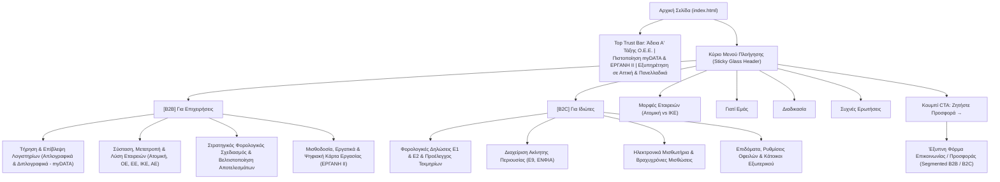

# TAX14 — Πλήρεις Προδιαγραφές Ιστοσελίδας, UX Αρχιτεκτονική & Ελληνικό Copywriting Framework

**Έργο:** Ιστοσελίδα Σύγχρονου Λογιστικού & Φοροτεχνικού Γραφείου στην Αθήνα (**TAX14 — Λογιστική & Φοροτεχνική Συμβουλευτική**)  
**Τοποθεσία:** Αθήνα, Αττική (Εξυπηρέτηση σε όλο το Λεκανοπέδιο Αττικής & Πανελλαδικά εξ αποστάσεως)  
**Υποδομή Φιλοξενίας:** Hostinger Web Hosting Unlimited (LiteSpeed Web Server, HTML5/CSS3/ES6+, PHP 8.x, `.htaccess`)  
**Repository:** `https://github.com/kostaskatsinas/tax14_site`

---

## 1. Στρατηγική Τοποθέτηση & Κοινό-Στόχος (Target Audience)

Η ιστοσελίδα διαχωρίζει καθαρά και άμεσα τις διαδρομές χρήστη (user journeys) σε δύο διακριτά τμήματα αγοράς:

### Α. Επιχειρήσεις & Ελεύθεροι Επαγγελματίες (B2B)
- **Νομικές Μορφές:** Ατομικές Επιχειρήσεις, Ο.Ε., Ε.Ε., Ι.Κ.Ε., Α.Ε. και Ελεύθεροι Επαγγελματίες.
- **Κύριες Ανάγκες:** Προληπτικός φορολογικός σχεδιασμός, πλήρης συμμόρφωση με τα ηλεκτρονικά βιβλία **myDATA της ΑΑΔΕ**, οργάνωση μισθοδοσίας & **Ψηφιακής Κάρτας Εργασίας (ΕΡΓΑΝΗ ΙΙ)**, και ηλεκτρονική σύσταση/μετατροπή εταιρειών μέσω **e-ΥΜΣ / Γ.Ε.ΜΗ.** χωρίς γραφειοκρατία.

### Β. Ιδιώτες & Ιδιοκτήτες Ακινήτων (B2C)
- **Προφίλ:** Μισθωτοί, συνταξιούχοι, ιδιοκτήτες/εκμισθωτές ακινήτων, κάτοικοι εξωτερικού και οικογένειες.
- **Κύριες Ανάγκες:** Ασφαλής υποβολή φορολογικών δηλώσεων (**Ε1, Ε2**) με προέλεγχο τεκμηρίων και ανάλωσης κεφαλαίου, διαχείριση περιουσιολογίου (**Ε9, ΕΝΦΙΑ**), ηλεκτρονικά μισθωτήρια συμβόλαια (αστικά, επαγγελματικά, βραχυχρόνιες μισθώσεις Airbnb/Booking), αιτήσεις επιδομάτων και ρυθμίσεις οφειλών (ΑΑΔΕ / ΕΦΚΑ).

---

## 2. Deliverable 1: Sitemap & Navigation (Αρχιτεκτονική Πληροφορίας)

### Δομή Κύριου Μενού (Header Navigation)
- **Αριστερά:** Λογότυπο **TAX14** + Υπότιτλος *«Λογιστική & Φοροτεχνική Συμβουλευτική»*
- **Κέντρο (Menu Items):**
  1. `[B2B] Για Επιχειρήσεις` (`#services-b2b`)
  2. `[B2C] Για Ιδιώτες` (`#services-b2c`)
  3. `Μορφές Εταιρειών` (`#entity-guide`)
  4. `Γιατί Εμάς` (`#why-us`)
  5. `Διαδικασία` (`#process`)
  6. `Συχνές Ερωτήσεις` (`#faq`)
- **Δεξιά (Primary Action):** Κουμπί **`Ζητήστε Προσφορά →`** (`#contact`)

### Δομή Υποσέλιδου (Footer Structure)
- **Στήλη 1 — Ταυτότητα & Πιστοποιήσεις:** Επωνυμία **TAX14**, περιγραφή γραφείου, σήμα **Μέλος Ο.Ε.Ε. • Άδεια Α' Τάξης**, **Αρ. Γ.Ε.ΜΗ.: 161400001000**.
- **Στήλη 2 — Υπηρεσίες Επιχειρήσεων (B2B):** Deep-links που προ-συμπληρώνουν τη φόρμα επικοινωνίας με την αντίστοιχη εταιρική υπηρεσία.
- **Στήλη 3 — Υπηρεσίες Ιδιωτών (B2C):** Deep-links για Ε1/Ε2, Ε9/ΕΝΦΙΑ, Μισθωτήρια, Επιδόματα/Ρυθμίσεις και Κατοίκους Εξωτερικού.
- **Στήλη 4 — Στοιχεία Επικοινωνίας (Αθήνα):** Διεύθυνση (Λεωφ. Βασιλίσσης Σοφίας 14, 115 28 Αθήνα), Τηλέφωνο (`210 300 1400`), Email (`info@tax14.gr`), Ωράριο (`Δευτέρα – Παρασκευή: 09:00 – 18:00`).
- **Bottom Legal Bar (GDPR & Νομική Συμμόρφωση):**
  - `Πολιτική Απορρήτου (GDPR)`
  - `Όροι Χρήσης`
  - `Πολιτική Cookies`

---

## 3. Deliverable 2: Πλήρες Wireframe & Ελληνικό Copywriting Αρχικής Σελίδας

### 3.1 Hero Section
- **Eyebrow Badge:** `ΣΥΓΧΡΟΝΟ ΛΟΓΙΣΤΙΚΟ & ΦΟΡΟΤΕΧΝΙΚΟ ΓΡΑΦΕΙΟ ΣΤΗΝ ΑΘΗΝΑ`
- **Κύριος Τίτλος (H1):**
  > **Στρατηγική Λογιστική & Σύγχρονη Φοροτεχνική Υποστήριξη στην Αθήνα, Χωρίς Γραφειοκρατία.**
- **Υπότιτλος (Subheadline):**
  > Από τη σύσταση και τον προληπτικό φορολογικό σχεδιασμό της επιχείρησής σας μέχρι την ολοκληρωμένη διαχείριση της προσωπικής σας περιουσίας. Αξιοποιούμε εξελιγμένα ψηφιακά εργαλεία, την πλατφόρμα **myDATA** και το **ΕΡΓΑΝΗ ΙΙ** για άμεση, έγκυρη και ασφαλή εξυπηρέτηση — είτε βρίσκεστε στην Αττική είτε σε οποιοδήποτε σημείο της Ελλάδας.
- **Dual CTAs:**
  - **Primary CTA:** `Κλείστε Δωρεάν Συμβουλευτικό Ραντεβού →`
  - **Secondary CTA:** `Εξερευνήστε τις Υπηρεσίες μας ↓`
- **Hero Interactive Visual (Δεξιά Στήλη):**
  Διαδραστικός πίνακας **«Ψηφιακός Έλεγχος TAX14»** με tabs εναλλαγής **`Επιχείρηση (B2B)`** και **`Ιδιώτης (B2C)`**, που προβάλλει δείκτες συμμόρφωσης myDATA, ΕΡΓΑΝΗ ΙΙ, e-ΥΜΣ/Γ.Ε.ΜΗ. και προέλεγχο Ε1/Ε2/Ε9/ΕΝΦΙΑ.

---

### 3.2 Service Segmentation Block («Οι Υπηρεσίες μας ανά Κατηγορία»)
Διαθέτει διαδραστικό φίλτρο (`Όλες οι Υπηρεσίες` | `Υπηρεσίες για Επιχειρήσεις (B2B)` | `Υπηρεσίες για Ιδιώτες (B2C)`) και δύο κεντρικές κάρτες:

#### Κάρτα Α: Για Επιχειρήσεις & Εταιρείες (B2B)
- **Τίτλος:** Λογιστική Υποστήριξη & Στρατηγικός Φορολογικός Σχεδιασμός Επιχειρήσεων
- **Υπηρεσίες & Micro-Copy:**
  1. **Τήρηση & Επίβλεψη Λογιστηρίων Όλων των Κατηγοριών (Απλογραφικά & Διπλογραφικά):** Οργανώνουμε και επιβλέπουμε πλήρως το λογιστήριό σας (Β' & Γ' κατηγορίας) με απόλυτη συμμόρφωση στα Ελληνικά Λογιστικά Πρότυπα (ΕΛΠ) και την πλατφόρμα **myDATA της ΑΑΔΕ**. Λαμβάνετε τακτική ενημέρωση για την πορεία του ΦΠΑ, των εξόδων και της ρευστότητάς σας, χωρίς εκπλήξεις της τελευταίας στιγμής.
  2. **Σύσταση, Μετατροπή & Λύση Εταιρειών (Ατομικές, ΟΕ, ΕΕ, ΙΚΕ, ΑΕ):** Αναλαμβάνουμε από το Α έως το Ω την ίδρυση της νέας σας επιχείρησης μέσω της ηλεκτρονικής Υπηρεσίας Μίας Στάσης (e-ΥΜΣ / Γ.Ε.ΜΗ.), τη σύνταξη καταστατικού, την επιλογή των κατάλληλων ΚΑΔ, καθώς και μετατροπές, συγχωνεύσεις ή λύση/εκκαθάριση εταιρειών μετά από αναλυτική οικονομοτεχνική μελέτη.
  3. **Στρατηγικός Φορολογικός Σχεδιασμός & Βελτιστοποίηση Αποτελεσμάτων:** Δεν καταγράφουμε απλώς ιστορικά στοιχεία· προβλέπουμε το φορολογικό σας αποτέλεσμα πριν το κλείσιμο της χρήσης. Αξιοποιούμε κάθε νόμιμη φορολογική έκπτωση δαπανών, υπερεκπτώσεις και αναπτυξιακά κίνητρα ώστε να ελαχιστοποιήσουμε τη συνολική φορολογική επιβάρυνση εταιρείας και εταίρων.
  4. **Πλήρης Διαχείριση Μισθοδοσίας & Εργατικών Θεμάτων (ΕΡΓΑΝΗ ΙΙ / Ψηφιακή Κάρτα Εργασίας):** Εκδίδουμε τη μισθοδοσία σας με ακρίβεια, διαχειριζόμαστε προσλήψεις, συμβάσεις, άδειες και ωράρια, και υποστηρίζουμε πλήρως την εφαρμογή της **Ψηφιακής Κάρτας Εργασίας (ΕΡΓΑΝΗ ΙΙ)** και τις υποβολές ΑΠΔ στον e-ΕΦΚΑ, θωρακίζοντας την επιχείρησή σας σε κάθε έλεγχο της Επιθεώρησης Εργασίας.

#### Κάρτα Β: Για Ιδιώτες & Ιδιοκτήτες Ακινήτων (B2C)
- **Τίτλος:** Φορολογικές Δηλώσεις, Ακίνητη Περιουσία & Παροχές Χωρίς Άγχος
- **Υπηρεσίες & Micro-Copy:**
  1. **Σύνταξη & Υποβολή Φορολογικών Δηλώσεων (Ε1, Ε2):** Ελέγχουμε διεξοδικά τα εισοδήματά σας, το όριο ηλεκτρονικών αποδείξεων (30%), τα τεκμήρια διαβίωσης/απόκτησης περιουσιακών στοιχείων και την ανάλωση κεφαλαίου προηγούμενων ετών πριν την οριστική υποβολή των εντύπων **Ε1** και **Ε2**, εξασφαλίζοντας τη μέγιστη δυνατή έκπτωση φόρου.
  2. **Διαχείριση Δηλώσεων Ακίνητης Περιουσίας (Ε9, ΕΝΦΙΑ):** Αναλαμβάνουμε την ορθή απεικόνιση, διόρθωση και επικαιροποίηση του περιουσιολογίου σας (**Ε9**) σε περιπτώσεις αγοραπωλησίας, γονικής παροχής, δωρεάς, τακτοποίησης αυθαιρέτων ή κληρονομιάς, καθώς και τον έλεγχο εκκαθάρισης και μείωσης του **ΕΝΦΙΑ** (π.χ. έκπτωση ασφαλισμένων κατοικιών).
  3. **Ηλεκτρονικά Μισθωτήρια Συμβόλαια:** Συντάσσουμε και υποβάλλουμε ηλεκτρονικά δηλώσεις πληροφοριακών στοιχείων μίσθωσης (κατοικίας, επαγγελματικής στέγης ή αγροτεμαχίων), τροποποιήσεις μισθώματος, παρατάσεις και δηλώσεις λύσης στην ΑΑΔΕ, καθώς και καταχωρήσεις στο Μητρώο Ακινήτων Βραχυχρόνιας Διαμονής (Airbnb / Booking).
  4. **Διαχείριση Αιτήσεων για Επιδόματα & Ρυθμίσεις Οφειλών:** Υποβάλλουμε έγκαιρα και χωρίς λάθη αιτήσεις για πάσης φύσεως επιδόματα (Α21 επίδομα τέκνων, επίδομα στέγασης, θέρμανσης, κοινωνικό τιμολόγιο) και σχεδιάζουμε βιώσιμες **ρυθμίσεις οφειλών** προς την Εφορία (ΑΑΔΕ) και τα Ασφαλιστικά Ταμεία (e-ΕΦΚΑ / ΚΕΑΟ).

---

### 3.3 Διαδραστικός Οδηγός Νομικών Μορφών & Live Προσομοιωτής Φόρου
- **Συγκριτικός Επιλογέας 4 Μορφών:** `01 Ατομική Επιχείρηση`, `02 Ο.Ε. / Ε.Ε.`, `03 Ι.Κ.Ε.`, `04 Α.Ε.` με δυναμική απεικόνιση Φορολογικού Συντελεστή, Κατηγορίας Βιβλίων, Ευθύνης Εταίρων, Ελάχιστου Κεφαλαίου και Ασφάλισης e-ΕΦΚΑ.
- **Live Προσομοιωτής (Ατομική vs Ι.Κ.Ε.):** Slider ετήσιων καθαρών κερδών (`15.000 €` – `150.000 €`) που συγκρίνει σε πραγματικό χρόνο την προοδευτική κλίμακα Ατομικής Επιχείρησης (9%–44%) με τον εταιρικό συντελεστή Ι.Κ.Ε. (22%) και εμφανίζει δυναμικό συμπέρασμα.

---

### 3.4 Why Choose Us («Γιατί να επιλέξετε εμάς» — Bento Grid 4 Πυλώνων)
1. **01 / Προσωποποιημένη Εξυπηρέτηση:** *Κάθε πελάτης είναι μοναδικός. Λύσεις προσαρμοσμένες στις ανάγκες και τους στόχους του.*
2. **02 / Σύγχρονη Ψηφιακή Προσέγγιση:** *Αξιοποίηση εξελιγμένων ψηφιακών εργαλείων και της πλατφόρμας myDATA για άμεση εξυπηρέτηση χωρίς άσκοπες μετακινήσεις.*
3. **03 / Έγκαιρη & Έγκυρη Ενημέρωση:** *Διαρκής παρακολούθηση της νομοθεσίας και αξιοποίηση κάθε φορολογικής ευκαιρίας.*
4. **04 / Εμπιστοσύνη & Εχεμύθεια:** *Σχέσεις ζωής βασισμένες στην ειλικρίνεια, τον επαγγελματισμό και την απόλυτη εχεμύθεια.*

---

### 3.5 How We Work («Η Διαδικασία Συνεργασίας» — 4 Βήματα)
1. **Βήμα 01 — Δωρεάν Διάγνωση & Ανάλυση Αναγκών:** Χωρίς δέσμευση, τηλεφωνικά, μέσω βιντεοκλήσης ή στο γραφείο μας στην Αθήνα.
2. **Βήμα 02 — Ξεκάθαρη Προσφορά & Πλάνο Δράσης:** Γραπτή, διαφανής οικονομική πρόταση χωρίς κρυφές χρεώσεις.
3. **Βήμα 03 — Ομαλή Παραλαβή Αρχείων ή Ηλεκτρονική Σύσταση:** Απευθείας συνεννόηση με τον προηγούμενο λογιστή για μεταφορά φακέλου (myDATA, ΕΡΓΑΝΗ ΙΙ, Ε9) ή ψηφιακή σύσταση μέσω e-ΥΜΣ.
4. **Βήμα 04 — Προληπτικός Έλεγχος & Διαρκής Υποστήριξη:** Καθημερινή παρακολούθηση από αποκλειστικό φοροτεχνικό σύμβουλο.

---

### 3.6 FAQ Section («Συχνές Ερωτήσεις»)
Περιλαμβάνει 5 αναλυτικές ερωταπαντήσεις (συνδεδεμένες και με `FAQPage` JSON-LD Schema):
1. *Μπορώ να αλλάξω λογιστή μέσα στη διάρκεια του έτους χωρίς να δημιουργηθεί πρόβλημα στα βιβλία μου;*
2. *Τι συμφέρει περισσότερο να ιδρύσω σήμερα: Ατομική Επιχείρηση ή Ι.Κ.Ε.;*
3. *Πώς διαχειρίζεστε την πλατφόρμα myDATA και την Ψηφιακή Κάρτα Εργασίας (ΕΡΓΑΝΗ ΙΙ);*
4. *Βρίσκομαι εκτός κέντρου Αθήνας ή δεν έχω χρόνο για μετακινήσεις. Μπορούμε να συνεργαστούμε εξ ολοκλήρου ψηφιακά;*
5. *Ως ιδιώτης με ακίνητα ή εισοδήματα από μισθωτές υπηρεσίες, γιατί να προτιμήσω το γραφείο σας αντί για μια απλή τυπική υποβολή Ε1;*

---

## 4. Deliverable 3: Smart Lead Capture & Intake Form («Φόρμα Επικοινωνίας & Προσφοράς»)

Η φόρμα διαθέτει **Segmented Switcher** στην κορυφή και προσαρμόζει δυναμικά τα πεδία και τους κανόνες επικύρωσης (validation):

| Κατηγορία | Πεδία που Εμφανίζονται |
| :--- | :--- |
| **Επιχείρηση / Επαγγελματίας (B2B)** | • **Επωνυμία Επιχείρησης ή Ονοματεπώνυμο** *(Υποχρεωτικό)* • **Νομική Μορφή:** Ατομική, Ι.Κ.Ε., Ο.Ε./Ε.Ε., Α.Ε./Ε.Π.Ε., Υπό Σύσταση *(Υποχρεωτικό)* • **Απασχόληση Προσωπικού (ΕΡΓΑΝΗ ΙΙ):** Χωρίς προσωπικό, 1–5, 6–20, 20+ • **Αντικείμενο Δραστηριότητας / Κλάδος** *(Υποχρεωτικό)* • **Υπηρεσία Ενδιαφέροντος:** Πλήρης Λογιστική Υποστήριξη (Αλλαγή Λογιστή), Τήρηση Λογιστηρίου (myDATA), Σύσταση/Μετατροπή/Λύση, Φορολογικός Σχεδιασμός, Μισθοδοσία & ΕΡΓΑΝΗ ΙΙ |
| **Ιδιώτης (B2C)** | • **Ονοματεπώνυμο** *(Υποχρεωτικό)* • **Θέμα Ενδιαφέροντος:** Δήλωση Ε1/Ε2, Ακίνητη Περιουσία Ε9/ΕΝΦΙΑ, Ηλεκτρονικά Μισθωτήρια/Airbnb, Επιδόματα & Ρυθμίσεις Οφειλών, Κάτοικοι Εξωτερικού *(Υποχρεωτικό)* • **Προφίλ Φορολογούμενου:** Μισθωτός/Συνταξιούχος, Ιδιοκτήτης Ακινήτων, Κάτοικος Εξωτερικού, Οικογένεια |
| **Κοινά Πεδία** | • **Τηλέφωνο Επικοινωνίας** *(Υποχρεωτικό - έλεγχος >=10 ψηφίων)* • **Διεύθυνση Email** *(Υποχρεωτικό)* • **Προτιμώμενος Τρόπος Επικοινωνίας:** Τηλεφωνικά, Online Video Call, Ραντεβού στο Γραφείο (Αθήνα), Email • **Σύντομο Μήνυμα / Διευκρινίσεις** • **Συγκατάθεση GDPR** *(Υποχρεωτικό checkbox με modal Πολιτικής Απορρήτου)* |

---

## 5. Deliverable 4: Local SEO & Metadata (Athens Focus)

### Meta Title & Description
- **Meta Title:** `Λογιστικό Γραφείο Αθήνα | TAX14 Φοροτεχνικοί Σύμβουλοι Επιχειρήσεων & Ιδιωτών`
- **Meta Description:** `Σύγχρονο λογιστικό & φοροτεχνικό γραφείο στην Αθήνα (TAX14). Τήρηση βιβλίων, σύσταση ΙΚΕ/Ατομικής, myDATA, μισθοδοσία ΕΡΓΑΝΗ ΙΙ, δηλώσεις Ε1-Ε2-Ε9 & ρυθμίσεις οφειλών. Ζητήστε προσφορά!`

### 10 High-Intent Ελληνικές Φράσεις-Κλειδιά (Αθήνα)
1. `λογιστικό γραφείο Αθήνα`
2. `λογιστής φοροτεχνικός Αθήνα`
3. `σύσταση ΙΚΕ Αθήνα`
4. `λογιστής myDATA επιχειρήσεις`
5. `τήρηση βιβλίων και μισθοδοσία Αθήνα`
6. `ψηφιακή κάρτα εργασίας ΕΡΓΑΝΗ ΙΙ λογιστής`
7. `έναρξη ατομικής επιχείρησης Αθήνα`
8. `φορολογικός σχεδιασμός επιχειρήσεων`
9. `φορολογικές δηλώσεις Ε1 Ε2 Ε9 Αθήνα`
10. `αλλαγή λογιστή επιχείρησης`

---

## 6. Deliverable 5: Art Direction, Design System & Compliance

### Χρωματική Παλέτα (*Athenian Sovereign Navy & Aegean Emerald/Gold*)
- **Sovereign Navy (Primary Dark):** `#060D1A`, `#0A1628`, `#0F213C`
- **Warm Alabaster & Pure Surface:** `#F8FAFC`, `#F1F5F9`, `#FFFFFF`
- **Aegean Emerald (Growth & Compliance Accent):** `#0D9488`, `#10B981`, `#14B8A6`
- **Athenian Bronze Gold (Prestige & Credentials):** `#C89D54`, `#E2BA78`

### Τυπογραφία (Full `greek` & `greek-ext` Support)
- **Display & Headings:** `Plus Jakarta Sans` (600, 700, 800)
- **Body & UI:** `Inter` (400, 500, 600, 700)
- **Οικονομικά Στοιχεία & Κωδικοί:** `JetBrains Mono` (`tabular-nums`)

### Θεσμικά Σήματα & Νομική Συμμόρφωση (GDPR)
- Σήματα αξιοπιστίας για **Οικονομικό Επιμελητήριο Ελλάδος (Ο.Ε.Ε. — Άδεια Α' Τάξης)**, **ΑΑΔΕ / myDATA**, **Π.Σ. ΕΡΓΑΝΗ ΙΙ & e-ΕΦΚΑ**, και **Γ.Ε.ΜΗ. (e-ΥΜΣ)**.
- Διαδραστικό **GDPR Cookie Banner** (`Αποδοχή Όλων` / `Μόνο Απαραίτητα`) και πλήρη νομικά modals για **Πολιτική Απορρήτου (GDPR)**, **Όρους Χρήσης** και **Πολιτική Cookies**.
